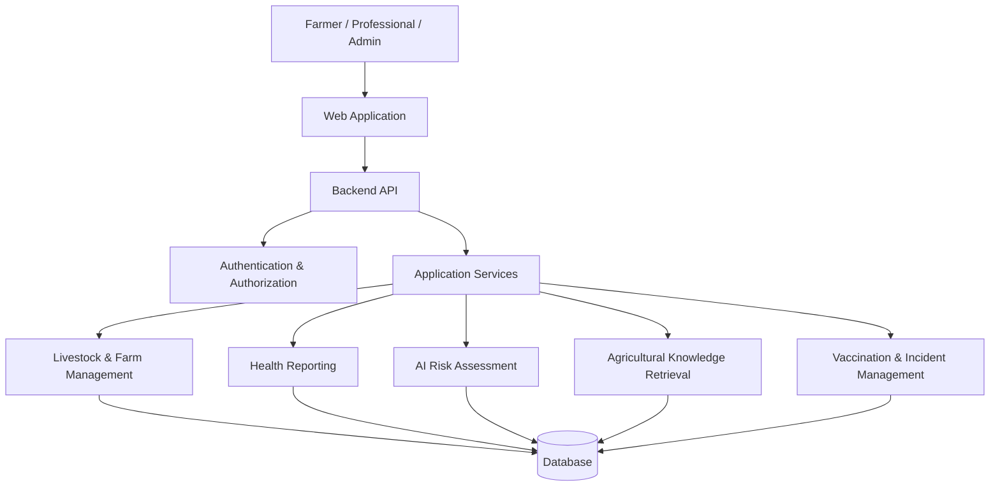

# 🐄 HerdGuard AI 🇿🇦

### Intelligent Livestock Health Monitoring, Disease-Risk Awareness & Agricultural Intelligence

<p align="center">
  <strong>Supporting smarter livestock management and agricultural intelligence in South Africa.</strong>
</p>

<p align="center">
  
  
  
</p>

---

## 🌍 About the Project

**HerdGuard AI** is a full-stack digital livestock health monitoring and agricultural intelligence platform developed to support South African farmers.

The platform initially focuses on cattle, with the potential to expand to sheep and goats. It aims to improve livestock management by combining digital animal records, health reporting, preliminary AI-assisted disease-risk assessments and accessible agricultural information.

Designed with communal, smallholder and commercial farming environments in mind, HerdGuard AI aims to make livestock health information and digital management tools more accessible.

## 🎯 The Problem

Livestock farming plays an important role in South Africa's agricultural economy and food security. However, farmers face several challenges:

- **Delayed disease awareness:** Unusual symptoms may go unnoticed or be reported too late.
- **Limited digital records:** Paper-based records can make livestock histories and vaccination information difficult to manage.
- **Information accessibility:** Farmers may struggle to find reliable and understandable livestock health information.
- **Disease monitoring:** Limited digital reporting tools can make it difficult to identify patterns in reported animal health concerns.

## 💡 The Solution

HerdGuard AI provides a centralized platform that helps farmers manage livestock information, report health concerns and access agricultural knowledge.

The platform brings together:

- Digital livestock and farm management.
- Animal health reporting and monitoring.
- Preliminary AI-assisted disease-risk assessment.
- Vaccination record management.
- Geographical disease incident visualization.
- An intelligent agricultural knowledge assistant.
- Role-based access for farmers, professionals and administrators.

## 🚀 Core Features

| Feature | Description |
|---|---|
| 👤 User Authentication | Secure account access and role-based permissions. |
| 🌾 Farm Management | Register farms and maintain farm information and locations. |
| 🐄 Livestock Management | Register cattle and maintain identification records. |
| 🩺 Health Reporting | Submit animal symptoms and health concerns. |
| 🤖 AI Risk Assessment | Generate preliminary health-risk assessments based on reported symptoms. |
| 💉 Vaccination Tracking | Maintain livestock vaccination information. |
| 🗺️ Disease Incident Mapping | Visualize reported livestock health incidents geographically. |
| 💬 Agricultural AI Assistant | Retrieve relevant information from a curated agricultural knowledge base. |
| 🔔 Notifications | Receive relevant platform updates. |
| 📊 Administration | Manage users, oversee reports and monitor platform activity. |

## 👥 User Roles

### 🧑‍🌾 Farmer
- Manage farms and livestock.
- Register individual animals.
- Submit health reports.
- View preliminary risk assessments.
- Maintain vaccination records.
- Access agricultural information.

### 🩺 Veterinary / Agricultural Professional
- Access authorized health reports.
- Review reported animal health concerns.
- Provide professional feedback where authorized.
- Support responsible livestock health monitoring.

### 🛡️ Administrator
- Manage users and permissions.
- Oversee submitted reports and incidents.
- Manage platform resources.
- Monitor administrative activities.

## 🧠 AI & Intelligent Features

HerdGuard AI incorporates two intelligent components.

### 1. Preliminary Disease-Risk Assessment

The platform uses a rule-based assessment approach to evaluate submitted symptoms and identify potential livestock health concerns.

Its initial disease knowledge scope includes:

- Foot-and-Mouth Disease (FMD).
- Lumpy Skin Disease.
- African Redwater.
- Blackquarter.
- Bovine Respiratory Disease Complex.

The assessment provides preliminary risk information to support awareness and reporting. It is not a veterinary diagnosis.

### 2. Agricultural Knowledge Assistant

The intelligent assistant uses information retrieval techniques to help users find relevant livestock health and agricultural information.

Its retrieval approach includes:

- TF-IDF vectorization.
- Cosine similarity.
- A curated agricultural knowledge base.

This approach helps retrieve relevant information based on the user's query.

## 🧰 Technology & Development

The following logos represent the main technologies and development ecosystem used in this project.

<p align="center">
  
</p>

<p align="center">
  <sub>Frontend • Backend • Database • Development & Version Control</sub>
</p>

## 🏗️ Application Architecture

HerdGuard AI follows a frontend-backend architecture.



## 💻 Getting Started

### Prerequisites

Ensure that you have the following installed:

- Python
- Node.js and npm
- Git

### 1. Clone the Repository

```bash
git clone https://github.com/AsavelaTshonisile/HerdGuard-AI.git
cd HerdGuard-AI
```

### 2. Backend Setup

Navigate to the backend directory:

```bash
cd backend
```

Create a virtual environment:

```bash
python -m venv venv
```

Activate the environment on Windows:

```powershell
venv\Scripts\activate
```

Install dependencies:

```bash
pip install -r requirements.txt
```

Configure the environment variables using `.env.example`, if provided.

Start the backend server:

```bash
uvicorn app.main:app --reload
```

### 3. Frontend Setup

Open another terminal and navigate to the frontend directory:

```bash
cd frontend
```

Install dependencies:

```bash
npm install
```

Start the frontend:

```bash
npm run dev
```

> **Note:** Confirm the folder names, backend entry point and commands against the actual project structure before publishing this guide.

## 📚 API Documentation

Interactive API documentation is available through the backend when the application is running:

**Swagger UI**

```text
http://127.0.0.1:8000/docs
```

**ReDoc**

```text
http://127.0.0.1:8000/redoc
```

## 🧪 Testing

Automated backend tests are managed using Pytest.

Run the tests from the backend directory:

```bash
pytest
```

## 🇿🇦 South African Agricultural Context

HerdGuard AI is designed around livestock health monitoring and agricultural information needs within South Africa.

The platform aims to complement existing agricultural and veterinary reporting processes. It does not replace official government reporting systems, state veterinary services or registered veterinary professionals.

Suspected disease incidents must be distinguished from professionally reviewed reports and officially confirmed outbreaks.

## 🔮 Future Development

Potential enhancements include:

- 🐑 Expanded support for sheep and goats.
- 📱 Improved mobile and offline functionality.
- 🌍 Multilingual support for South African farmers.
- 📍 Enhanced geographical disease monitoring.
- 🔗 Integration with verified agricultural information sources.
- 📈 Advanced livestock analytics and reporting.

## 🤝 Contributing

Contributions, suggestions and feedback are welcome.

1. Fork the repository.
2. Create a feature branch.
3. Implement your changes.
4. Test your changes.
5. Submit a pull request.

## ⚕️ Disclaimer

HerdGuard AI provides agricultural information and preliminary livestock health-risk assessments. Its assessments are not substitutes for professional veterinary diagnosis, treatment or advice.

Farmers should contact a qualified veterinary professional or the relevant state veterinary authority when they observe concerning symptoms or suspect a notifiable animal disease.

The platform does not independently confirm disease outbreaks or authorize veterinary treatment.

## 📄 License

This project is intended to use the MIT License. Refer to the repository's `LICENSE` file once it has been added.

---

<p align="center">
  <strong>🐄 HerdGuard AI 🇿🇦</strong>
  <br />
  Building smarter approaches to livestock health monitoring and agricultural intelligence.
</p>
