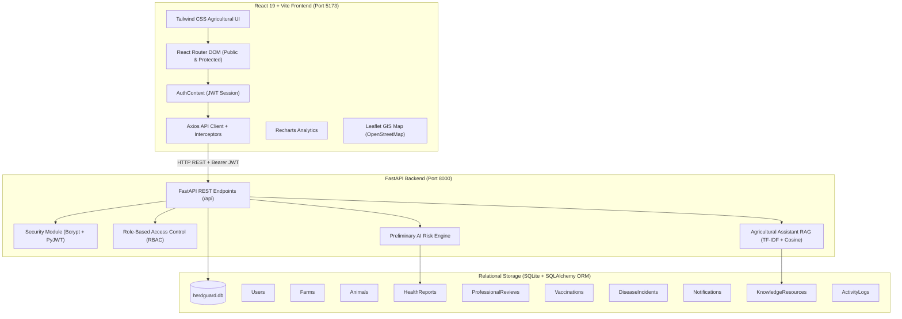

# HerdGuard AI - System Architecture & Technical Specifications

## 1. System Overview
**HerdGuard AI** is a production-minded web application engineered for the South African livestock sector (with initial focus on cattle, extensible to sheep and goats). It provides digital animal record tracking, early syndromic health reporting, transparent preliminary AI-assisted risk assessment, geographical disease outbreak surveillance, statutory vaccination scheduling, and retrieval-augmented agricultural guidance.

---

## 2. Full-Stack Architecture

---

## 3. Database Entity Design (SQLAlchemy ORM)

The relational database is implemented in **SQLite** via **SQLAlchemy 2.0**:

1. **User**: Represents platform actors with distinct roles:
   - `farmer`: Smallholder, communal, and commercial cattle owners.
   - `professional`: South African Animal Health Technicians (AHTs) and registered veterinarians.
   - `admin`: Operational administrators managing users, disease verifications, and knowledge assets.
2. **Farm**: Land parcels located across South Africa's 9 provinces with municipality and numeric latitude/longitude coordinates.
3. **Animal**: Cattle tagged with official or farm ear tag numbers, breed (e.g. Bonsmara, Nguni, Brahman), sex, age, weight, and clinical status.
4. **HealthReport**: Structured symptom reports (JSON encoded symptoms, severity, duration, first noticed date, unique reference number `HG-YYYY-XXXX`, and parsed AI risk output).
5. **ProfessionalReview**: Official clinical feedback, differential considerations, isolation recommendations, and follow-up schedules added by veterinarians.
6. **Vaccination**: Records of mandatory and core SA cattle inoculations (Anthrax, Brucellosis S19, Blackquarter, Lumpy Skin Disease) with automated upcoming/overdue calculation.
7. **DiseaseIncident**: Geographical disease reports categorized by verification level (`Suspected`, `Professionally Reviewed`, `Official Outbreak`).
8. **Notification**: Database-stored in-app alerts with read/unread flags.
9. **KnowledgeResource**: Curated agricultural guidelines from DALRRD and ARC Onderstepoort.
10. **ActivityLog**: Complete audit trail of system events.

---

## 4. AI & Machine Learning Design

### A. Modular Clinical Risk Assessment Engine
- **Pattern Matching**: Evaluates structured symptom combinations against documented cattle clinical syndromes (Vesicular/FMD-like, acute tick-borne, clostridial necrosis, bovine respiratory disease complex, nodular dermatosis).
- **Risk Tiers**: Classifies reports into `Low Risk`, `Moderate Risk`, `High Risk`, and `Urgent Attention Required`.
- **Escalation Rules**: Escalates risk category when severity is marked `severe` or duration exceeds 3 days.
- **Safety Disclaimers**: Explicitly communicates that outputs are preliminary decision-support indicators, does not prescribe medication, and instructs users to contact the State Veterinarian for high-risk incidents.
- **Extensibility**: Structured with clean interfaces so trained Scikit-Learn or XGBoost classification models can complement or replace the rules engine as validated South African veterinary training datasets become available.

### B. Retrieval-Augmented Generation (RAG) Assistant
- **Curated Knowledge Base**: Vectorized repository of official publications from the Department of Agriculture, Land Reform and Rural Development (DALRRD) and Agricultural Research Council (ARC).
- **Local Fallback Retrieval**: Uses Scikit-Learn's `TfidfVectorizer` and cosine similarity to retrieve relevant biosecurity guidance without requiring cloud API keys.
- **Citations & Guardrails**: Displays source attribution and South African statutory disclaimers on every advisory output.
